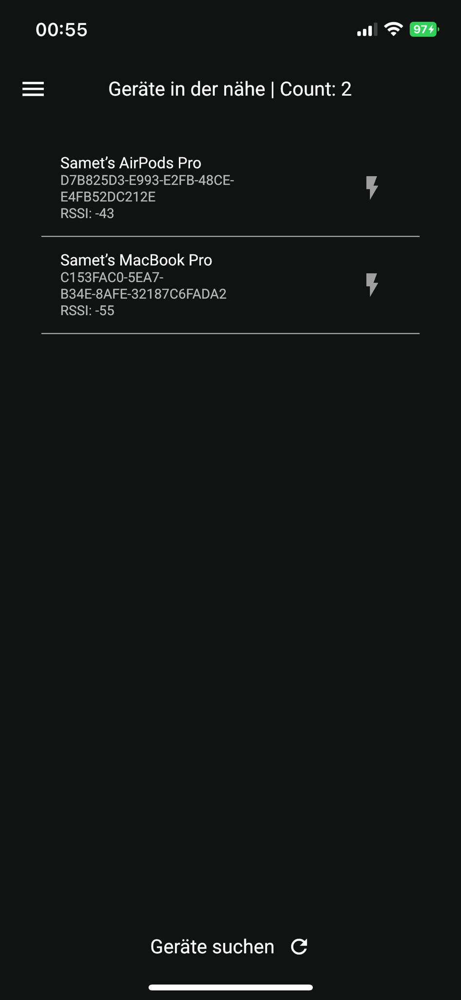
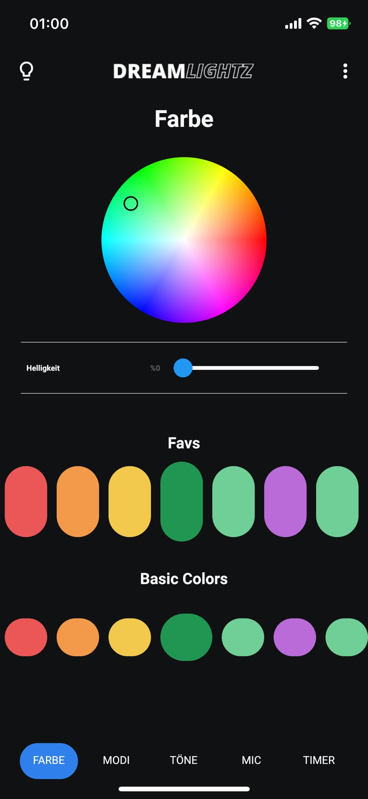
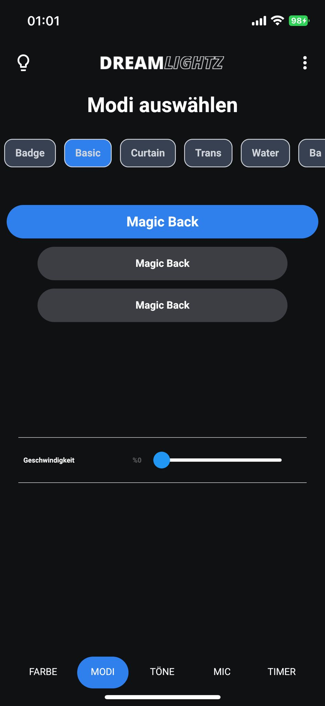
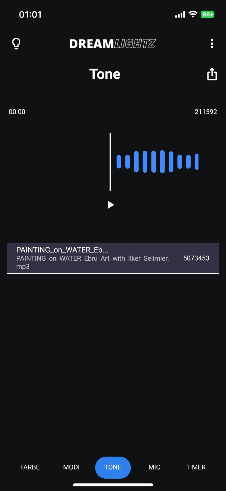
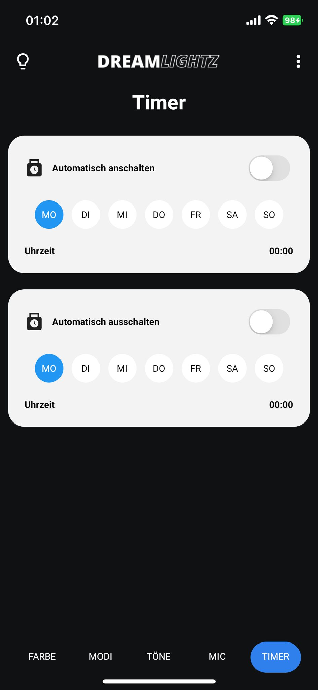

# LED Blue

A Flutter app that controls a Bluetooth Low Energy LED controller from your phone: pick colours, switch lighting modes, set timers, and make the lights react to music or the microphone.

## Features

- **Device discovery**: scan for nearby BLE devices, check Bluetooth status and permissions, connect and disconnect
- **Colour control**: preset colour swatches and a full colour picker
- **Modes** ("modi"): choose built-in lighting effects
- **Timer**: set an hour/minute timer on the controller
- **Music sync**: pick an audio file, see its waveform and drive the LEDs with it
- **Microphone sync**: react to ambient sound using live microphone input and a noise meter
- Device log and a raw characteristic read/write dialog for debugging
- Settings, about and feedback screens

## Stack

- Flutter (Dart ≥ 2.18), Provider
- [`flutter_reactive_ble`](https://pub.dev/packages/flutter_reactive_ble) for scanning, connecting and writing characteristics
- `flutter_colorpicker`, `audio_waveforms`, `just_audio`, `mic_stream`, `noise_meter`, `file_picker`

## Project structure

```
led_blue/lib/src/
  ble/                 scanner, connector, device interactor, status monitor, logger
  ui/                  launch screen, BLE status, device list
  ui/device_detail/    colour tab, modes, timer, music (tone), microphone, log
  global_screens/      settings, about, feedback
```

## Run locally

```bash
cd led_blue
flutter pub get
flutter run
```

Run on a physical device: BLE scanning does not work in simulators or emulators.

## Screenshots

<p>
  
  
  
  
  
</p>
